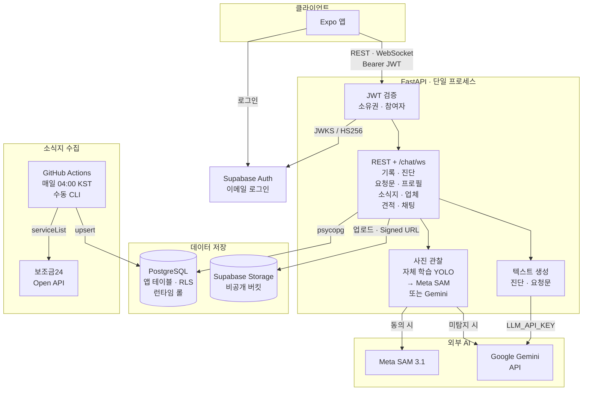

# 서비스 구조

구현된 코드 기준의 논리 구조다. 배포 토폴로지·프록시·오토스케일은 다루지 않는다.

## 구성

## 경계와 제약

- **클라이언트**: 앱은 Supabase Auth로만 직접 통신한다. 하단 탭은 소식·분석·채팅·업체·정보 5개이고, 채팅 탭은 별도 `/dm` 스택 화면을 연다. 데이터·사진·모델 호출은 모두 FastAPI를 거치며, 앱 번들에는 publishable key만 둔다.
- **인증·인가**: FastAPI가 Supabase JWT를 검증하고(HS256 공유 시크릿 또는 JWKS), 기록 소유자·채팅 참여자·견적 요청서 역할을 요청마다 확인한다. DB는 `career_pair_runtime` 롤만 접근하며 Supabase Data API 권한은 회수돼 있다. DB 버전은 코드에서 고정하지 않고 Supabase 인스턴스 설정을 따른다.
- **사진**: 원본은 저장하지 않는다. 긴 변 1600px·EXIF 제거 JPEG만 비공개 버킷에 올리고, 조회는 300초 Signed URL로 제한한다. SAM·Gemini 비전 전송은 사용자 동의와 서버 키가 모두 있을 때만 한다.
- **모델**: 자체 학습 YOLO 체크포인트(`models/best.pt`: 균열·벗겨짐)로 사진을 탐지하고, Meta SAM 3.1과 Google Gemini API는 서버 환경변수 키로만 호출한다. 모델 키·프롬프트·원본 사진은 로그에 남기지 않는다.
- **소식지 배치**: 조회 API는 DB만 읽는다. 수집은 `python -m app.support_sync`가 보조금24를 페이지 단위로 받아 한 트랜잭션으로 upsert하며, 실패하면 기존 행을 유지한다.
- **확장 제한**: 채팅 WebSocket 연결 레지스트리는 API 프로세스 메모리에 있다. 다중 워커·다중 인스턴스로 확장하려면 공유 브로커가 필요하다.
