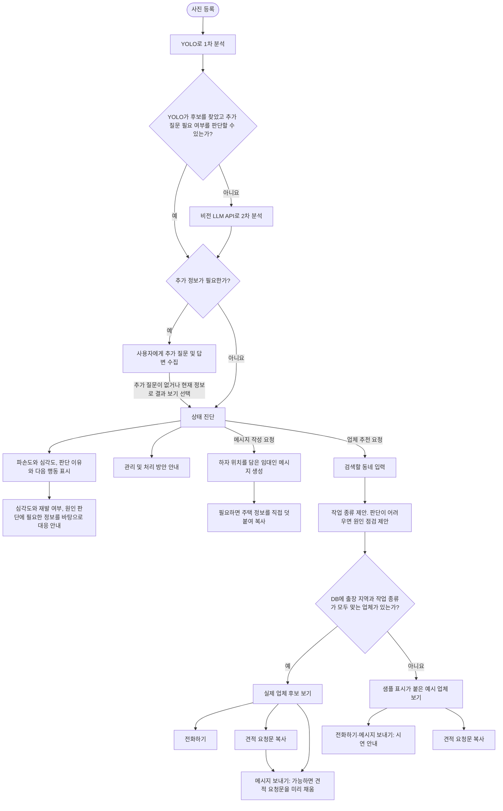

# 청년 임차인을 위한 주거 하자 대응 에이전트

팀은 3명이며 11월 22일까지 완성하는 것을 목표로 한다. 공식 제출 마감은 11월 23일 17:00이다. [공식 해커톤 안내](https://korcham-careerfair.com/hackathon)

청년 임차인이 집에서 하자를 발견했을 때, 사진과 추가 답변으로 상태를 파악하고 직접 조치, 임대인 점검 요청, 업체 연락 중 필요한 다음 행동으로 이어가도록 돕는다.

## 공식 제출 요건

- 필수 제출물은 지정 양식의 프로젝트 소개서, AI 활용내역, 실행 가능한 프로토타입이다. 소개서 별첨에 외부 자원의 출처·라이선스·이용 조건을 기록한다. 22일에는 팀 내부 개발 환경 밖에서도 제출본이 실행되는지 확인한다. [프로젝트 소개서 양식](https://drive.google.com/file/d/15gESCgdavnFcTF9xTV_3R2nZyhGbgC-P/view)
- 대표자가 신청 후 받은 링크에 업로드하고, 동일한 자료를 `korcham.careerfair@gmail.com`으로도 보낸다. 파일명은 `[팀명]_프로젝트명_AI 해커톤_제출일자`, 메일 제목은 같은 문자열 뒤에 ` / 과제제출`을 붙인다.
- 상세 목록에서 3분 이내 시연 영상과 개발 설명 자료는 선택 항목이다. 별도 공지의 요약에도 두 항목이 열거되어 있으므로 실제 제출 폼에서 필수 여부와 파일 형식을 확인한다.
- 예선 배점은 AI 활용 25점, 문제 정의 20점, 차별성 20점, 구현 20점, 활용·확장 15점이다. AI 오류·불확실성 대응은 AI 활용 25점 중 5점이다. 제출 마감 후 평가 대상 기능·알고리즘·프롬프트·데이터 변경은 금지된다. [공식 해커톤 안내](https://korcham-careerfair.com/hackathon)

### 첨부3 AI 활용 및 출처 표기 기준

- **AI 활용내역은 3,000자 이내**로 ① 서비스·개발에 사용한 모델과 도구 ② AI 작업과 팀 기여 ③ API·외부 데이터·오픈소스 ④ 검증 및 한계 대응 순으로 쓴다. 이 프로젝트의 AI 브레인스토밍·자료 조사·문서 초안도 실제 활용 범위에 포함한다. 코드 생성 비율 제한은 없으며 팀이 핵심 결정·검증을 주도하고 동작과 오류 대응을 설명할 수 있어야 한다.
- **외부 자원은 실제 사용분의 출처와 이용 조건을 확인한다.** YOLO·SAM·비전 LLM·MCP 등 채택한 모델·도구, 학습 및 검증 이미지와 데이터셋, 기타 오픈소스·미디어의 상세 출처를 소개서 별첨에 기록한다. 저장소를 선택 제출하면 README에도 Credits / Licenses를 작성한다. AI 생성 이미지·영상에는 AI 생성 여부와 도구명을 표기한다. 사전 개발물을 사용했다면 제출 설문과 소개서 별첨에 종류·개발 시기·활용 범위를 동일하게 기록한다.
- **심사 기간 동안 실행을 유지한다.** 22일에는 팀 계정에서 로그아웃한 환경에서 심사위원의 접근·실행 경로를 확인한다. 예선 종료일인 11월 30일까지, 본선 진출 시 12월 7일까지 배포와 API 사용량·과금 설정을 유지한다. API 키·비밀번호·토큰은 코드·영상·발표자료에 노출하지 않는다. AI가 생성한 응답은 화면에 표시하는 것이 권장된다.
- 저장소 제출 시 제출 버전을 태그나 커밋으로 기록하는 것이 권장된다. 마감 후 허용되는 접속·인증정보·실행 환경 복구가 필요하면 운영사무국에 사유와 변경 내용을 알리고 이력을 남긴다. [AI 활용 및 출처 표기 기준 PDF](https://drive.google.com/file/d/1PPCIMds1RBXces430OeGF2D7mQWkrdyj/view)

## 팀 회의에서 나온 흐름 (검토 중)

MVP에는 업체 후보를 보여주고 사용자가 선택한 업체에 연락할 수 있는 단계까지 포함한다. 후보마다 `전화하기`와 `메시지 보내기`를 제공한다. 샘플 업체의 연락 버튼은 시연 안내를 띄우며, 견적 요청문 복사는 사용할 수 있다. 사용자는 후보 목록에서 하자 기록을 바탕으로 만든 견적 요청문을 복사해 여러 업체에 메시지로 보낼 수 있다. 재촬영은 보류한다.

## 합의한 범위

- 같은 하자의 전체 사진과 근접 사진을 최대 두 장 받는다. 한 장으로 시작할 수 있으며 두 번째 사진은 선택이다. 부족한 정보는 채팅으로 확인한다. 전체 사진은 위치와 퍼진 범위, 근접 사진은 표면의 흔적을 확인하는 데 사용한다. 실제 면적 측정은 기준물 촬영 또는 깊이 측정을 검증한 뒤 도입할 후속 후보로 둔다.

- 지원할 하자 유형은 미정이다. 창가에 곰팡이로 의심되는 흔적이 닦은 뒤 다시 나타난 사례는 시연 후보다.
- 상태 진단에서 파손도와 심각도를 보여주고, 심각도를 기준으로 사용자가 혼자 해결할 수 있는지 안내한다. 직접 조치를 권하기 전에 재발 여부와 원인을 판단할 정보가 충분한지 확인한다. 흔적이 작아도 재발했거나 원인이 불명확하면 점검을 권한다. 심각도는 `낮음`, `중간`, `높음`으로 표시한다. 정보가 부족하면 `판단 보류`로 표시한다. 판단 이유와 다음 행동을 함께 보여준다. 단계별 기준은 데모에서 지원할 하자 유형을 정한 뒤 사례별로 정한다.
- 사용자가 사진을 올리고 AI의 추가 질문에 답하면, 하자 기록을 바탕으로 점검 요청문을 생성한다. 사용자는 문구를 확인하고 복사할 수 있다.
- 임대인에게 보낼 점검 요청문에는 침실 창가처럼 집 안에서 하자가 생긴 위치를 넣는다. 어느 집인지 알려줄 필요가 있으면 사용자가 주택 정보를 직접 덧붙인다. 업체 추천을 요청할 때는 검색할 동네만 입력한다.
- 점검을 권하는 경우 결과 화면의 주 버튼은 `임대인에게 보낼 점검 요청문`이다. 직접 조치를 권하는 경우 결과 화면에 처리 방법과 필요한 준비물을 바로 보여준다. 사용자가 가진 도구를 묻고 답변에 따라 처리 방법을 바꾸는 기능은 후속 범위다. `업체 찾기`는 임대인에게 점검을 요청하기 전에도 선택할 수 있다. 업체 후보 목록에서 같은 하자 기록을 바탕으로 만든 견적 요청문을 복사할 수 있다. 업체 후보마다 `전화하기`와 `메시지 보내기`를 제공하며, `메시지 보내기`를 누르면 기기가 지원하는 경우 기존 견적 요청문을 메시지 작성 화면에 미리 채운다. 자동 채우기를 사용할 수 없으면 복사한 요청문을 직접 붙여 넣는다. 사용자가 내용을 확인하고 전송한다. 임대인 메시지의 앱 내 발송과 가격 비교는 후속 범위다. 업체 입찰은 팀원이 제안한 확장 목표다.
- 사진 분석 결과와 사용자의 답변을 바탕으로 업체 검색에 쓸 작업 종류를 정해 미리 선택한다. 답변에 따라 작업 종류가 달라질 때는 추가 질문으로 확인한다. 추가 질문 후에도 어떤 작업이 먼저인지 판단하기 어려우면 원인 점검을 기본으로 선택하고 추천 이유를 짧게 보여준다. 사용자는 제안된 작업으로 바로 검색하거나 필요할 때 수정할 수 있다.
- 업체 검색이 성공하면 DB에서 사용자가 입력한 동네로 출장할 수 있고 해당 하자에 맞는 작업을 제공하는 실제 업체를 보여준다. 일치하는 업체가 없으면 예시 데이터를 보여주고 목록에 `샘플`이라고 표시한다. 조회 오류는 별도로 표시한다.
- 로그인과 `새 하자 기록`을 MVP에 포함한다. 시연에는 팀이 미리 준비한 계정을 사용하고, 앱 내 회원가입과 비밀번호 재설정은 후속 범위다. 새 기록을 시작하면 이전 사진·답변·초안이 새 사례에 섞이지 않는다. 최근 기록 목록은 보류한다. 시연에서 같은 하자 기록을 나중에 다시 열어야 할 때만 MVP에 포함한다.
- 앱은 권장 연락 대상과 이유를 제시한다. 수리비 부담에 대해서는 계약 내용과 점검 결과 등 확인할 정보를 안내한다. [민법 제623조 및 제634조](https://www.law.go.kr/lsSc.do?eventGubun=060101&menuId=1&query=%EB%AF%BC%EB%B2%95&section=&subMenuId=15&tabMenuId=81)

## 기술 스택과 역할

| 담당 | 기술 | 작업 |
| --- | --- | --- |
| 앱 1명 | React Native · Expo | 로그인, 새 하자 기록 시작, 사진 입력, 추가 질문, 결과 검토와 요청문 복사, 업체 후보 목록과 전화·메시지 연결 |
| 백엔드 1명 | FastAPI · Supabase(DB) | 인증 확인, 사용자별 하자 기록 저장과 접근 권한, LLM 질문과 요청문 생성, 이미지 분석 결과 연동, 업체 검색과 DB 등록 |
| 이미지 인식 1명 | 모델과 적용 범위는 담당자와 협의 | 데이터 확인, 모델 검증, 백엔드에 전달할 분석 결과 협의 |

## 대표 사용자와 차별점

관리 전용 앱이 없는 임차인도 사진과 답변으로 하자 기록을 만들고, 평소 쓰는 연락 채널로 임대인에게 점검을 요청할 수 있다. 필요한 경우 같은 기록으로 견적 요청문도 만든다.

| 비교 서비스 | 공개된 기능 | 우리 데모에서 보여줄 부분 |
| --- | --- | --- |
| 숨고 | 곰팡이 제거 서비스와 업체 견적 | 업체를 정하기 전 임대인에게 점검을 요청하는 단계 |
| AppFolio Realm-X | 사진 분석, 후속 질문, 작업 주문 생성 | 관리 플랫폼 연동 없이 임차인이 기록을 검토하고 자신의 연락 채널로 전달하는 흐름 |

[숨고 곰팡이 제거 견적 안내](https://frontend-next.soomgo.com/prices/%EA%B3%B0%ED%8C%A1%EC%9D%B4-%EC%A0%9C%EA%B1%B0) · [AppFolio Realm-X 기능 안내](https://www.appfolio.com/blog/small-medium-business)

창가 얼룩 사례를 시연한다면 새 하자 기록을 시작해 같은 사진에 다른 재발 이력을 입력하고, 답변에 따라 점검 요청문이 달라지는 모습을 보여준다. 업체 후보 목록에서 기존 정보를 다시 입력하지 않고 견적 요청문을 복사해 메시지에 붙여 넣는다.

### 차별점 보완 후보

구현 난이도, 한계, 검증 방법과 추가 기능 후보를 [AI 아이디어 비교](../ideas/AI_IDEAS.md)에 정리했다.

1. **임대인 답장으로 후속 대응 초안 만들기.** 답장을 자동으로 가져올 수 있는 경로를 확보할 때 다시 검토한다. 기존 제안은 답장 붙여넣기였다. 기존 하자 기록 하나와 텍스트 입력으로 구현할 수 있지만, 팀은 수동 입력이 필요하면 활용 가치가 낮다고 봤다. 카카오톡 공개 메시지 API에서 개인 대화 수신 조회는 확인되지 않았다. 앱 공유를 통한 가져오기는 사용자 동작이 필요한 별도 후보다. [카카오톡 메시지 API](https://developers.kakao.com/docs/ko/kakaotalk-message/common) · [Expo Sharing](https://docs.expo.dev/versions/latest/sdk/sharing/)
2. **기록을 바탕으로 전달 전 누락과 단정 확인.** AI가 요청 초안에서 근거가 없는 원인 단정이나 누락된 위치 정보를 찾아 사용자에게 수정할 곳을 보여준다. 별도 화면을 추가할 여유가 없을 때, 기존 초안 검토 화면에서 구현할 수 있는 후보다.
3. **견적서의 작업 범위 비교.** 받은 견적에서 원인 점검, 제거, 마감 복구 항목을 뽑아 비교하고 명시되지 않은 항목에 대해 업체에 물을 질문을 만든다. 실제 견적 사례가 필요하고 이번 데모의 임대인 연락 흐름보다 뒤 단계라 후속 후보로 둔다.

AppFolio도 사진 분석, 후속 질문과 작업 주문 생성을 제공한다. 위 후보는 임차인이 평소 쓰는 연락 채널에서 받은 답장을 기존 하자 기록에 이어 쓰는 경험을 검증하기 위한 것이다. 경쟁 서비스 전체에서의 기능 유일성은 확인 전이다. [AppFolio Realm-X 기능 안내](https://www.appfolio.com/blog/small-medium-business)

### 후속 후보: RAG·MCP

민법 조문 조회 MCP와 RAG는 후속 후보로 둔다. 이번 시연은 사진 분석과 추가 질문이 직접 조치 안내, 임대인 점검 요청, 업체 추천으로 이어지는 흐름에 집중한다.

**후속 탐색 후보는 민법 조문 조회 MCP다.** 결과 화면의 `왜 임대인에게 먼저 알리나요?`에서 읽기 전용 도구가 관련 조문을 가져온다. 응답에는 조문 번호, 원문, 시행일, 출처 링크를 포함한다. 앱은 확인된 사례 사실, 조문이 설명하는 일반 원칙, 원인·계약 특약처럼 추가로 확인할 정보를 보여준다. 조문 조회에는 사용자의 사진, 주소, 대화 원문을 전달하지 않는다. 조회 실패 시 근거를 가져오지 못했음을 표시하고 기존 점검 요청문 흐름은 이어간다. 법제처 API 접근과 기존 커뮤니티 MCP의 동작을 먼저 확인한다. [법제처 API 안내](https://open.law.go.kr/LSO/openApi/guideList.do)

| 후보 | 사용자에게 보여줄 결과 | 검증할 점 |
| --- | --- | --- |
| RAG로 임대인 답장에 대응 | 기존 하자 기록과 답장을 바탕으로 검토한 공식 자료에서 관련 항목을 찾아, 확인할 사실과 보낼 답장 초안을 원문 링크와 함께 제시한다. | 검색 결과가 질문과 실제로 관련 있는지, 인용이 안내를 뒷받침하는지, 근거가 부족할 때 비용 부담 판단을 보류하는지 확인한다. |
| MCP로 공식 경로 조회 | 임대인 연락 이후에도 해결되지 않을 때 AI가 읽기 전용 도구로 상담·조정 기관이나 준비 서류를 조회해 공식 링크를 제시한다. | 조회 도구와 데이터 접근이 가능한지, 결과가 비거나 호출이 실패할 때 어떻게 안내할지 확인한다. 검색에는 개인 사진이나 대화 원문을 전달하지 않는다. |
| MCP로 하자 기록 재사용 | 사용자가 선택한 하자 기록에서 확인된 사실을 조회해 점검·답장·견적 초안에 재사용한다. | FastAPI 내부에서 같은 기록을 읽는 방식으로도 현재 앱의 요구를 충족한다. 여러 AI 앱에서 같은 도구를 재사용할 필요가 생기면 MCP 도입 근거가 된다. |

[국가법령정보 공동활용](https://open.law.go.kr/LSO/information/service.do) · [MCP 공식 명세 안내](https://blog.modelcontextprotocol.io/posts/2026-07-28/)

## 질문과 초안 생성

- 답이 진단이나 다음 행동을 바꿀 때만 한 번에 하나씩 묻는다. 이미 받은 답을 재질문하지 않는다.
- 의미 있는 추가 질문이 없거나 사용자가 `현재 정보로 결과 보기`를 선택하면 현재 정보로 진단 결과를 보여준다. 답하지 않은 사실은 미확인으로 남긴다. 심각도를 판단할 정보가 부족하면 `판단 보류`를 표시한다.
- 사진에서 관찰한 흔적과 사용자가 알려준 사실을 구분한다. 예를 들어 사진의 얼룩을 원인으로 확정하지 않고 사용자가 답한 재발 여부를 요청문에 반영한다.

### 질문·초안 생성이 실패했을 때

| 실패 지점 | 화면에서 이어갈 수 있는 행동 |
| --- | --- |
| 다음 질문 생성 | `다시 시도` 또는 `현재 정보로 결과 보기`를 제공한다. 입력한 답변은 유지한다. |
| 점검 요청문 또는 견적 초안 생성 | `다시 시도`와 `기본 양식 보기`를 제공한다. 기본 양식은 LLM 호출 없이 현재 하자 기록에서 사용자가 확인한 위치·증상·이미 해본 조치 중 입력된 항목만 채운다. 사용자는 양식을 수정하고 복사할 수 있다. |

생성 실패를 앱에 표시하고, 재시도할 때 같은 하자 기록을 사용한다. 질문 생성에 앞서 받은 답변을 저장하며, 실패 응답으로 기존 초안을 덮어쓰지 않는다.

## 통합 계획

Expo에서 사진을 FastAPI로 보내고, 앱은 서버가 반환한 사진 분석 상태와 다음 질문을 표시한다. FastAPI는 로그인한 사용자의 답변과 하자 기록을 Supabase DB에 저장하고, 해당 사용자가 소유한 기록으로 점검 요청문과 견적 요청문을 만든다.

11월 20일 통합에서는 앱과 백엔드를 샘플 분석 결과로 먼저 연결한다. 실제 모델은 동일 사진 비교 후 연결한다. 분석 결과에는 의심 유형과 표시 영역을 담을 수 있게 하고, 결과가 없을 때는 사용자가 위치와 증상을 입력해 질문과 초안 작성으로 이어간다. 시연에서 샘플 결과를 사용하면 화면이나 발표에서 샘플임을 밝힌다.

## 사진 분석의 불확실성 대응

학습에 쓰지 않은 동일 사진으로 YOLO와 비전 LLM을 먼저 비교한다. 지원할 하자 유형을 정한 뒤 비교 결과를 바탕으로 비전 LLM 모델과 YOLO의 구체적인 신뢰도 기준을 이미지 인식 담당자와 협의한다.

- YOLO가 하자 후보를 찾지 못했거나 결과가 불명확해 다음 질문을 정하기 어려우면, 비전 LLM에 YOLO의 결론을 주지 않고 사진에서 보이는 흔적, 대략적 위치, 판독이 어려운 이유를 묻는다.
- 비전 LLM을 호출하지 않은 경우, YOLO가 찾은 영역을 사진 위에 `의심 흔적`으로 표시하고 사용자가 위치와 증상을 확인하거나 수정할 수 있게 한다. 두 분석에서 모두 의심 영역을 찾지 못하면 `사진에서 의심 영역을 찾지 못했어요`를 표시하고 직접 입력으로 이어간다. 분석 요청이 실패해 사용할 결과가 없으면 실패를 표시하고 직접 입력으로 이어간다.
- 두 분석이 일치하면 화면에 `의심 흔적`으로 표시한다. 비전 LLM만 관찰을 반환하거나 두 결과가 다르면 후보로 보여주고 사용자에게 위치와 보이는 증상을 확인한다. 사진 자체가 흐리거나 어두우면 직접 입력할 수 있게 한다. 재촬영은 보류한다.
- 두 모델이 일치해도 유형과 원인을 확정하지 않는다. 요청문에는 사진에 보이는 현상, 사용자가 확인한 사실, 추가 점검이 필요한 내용을 구분한다. 모델 호출이 실패해도 직접 입력으로 요청문을 만들 수 있다.

### 주거 사진 처리 기준

- 원본 사진은 앱의 현재 분석·결과 화면과 FastAPI의 분석 요청 처리에만 사용한다. Supabase, 서버 로그, 백업에 사진을 남기지 않는다. 서버 임시 파일을 사용하면 처리 성공·실패 모두에서 삭제한다. 사용자 기기의 사진 보관함에 있는 원본은 사용자가 관리한다.
- Supabase에는 사용자별 하자 기록에 필요한 위치·증상·답변·초안을 저장한다. 사진과 표시 영역은 현재 세션에서만 사용한다.
- 대회에서는 동의 여부와 관계없이 실제 개인정보·민감정보를 외부 AI 서비스에 보내지 않는다. 외부 비전 모델에는 팀이 확인한 가상·샘플·비식별 사진만 보낸다. 호출 전에 사진과 제공사, 목적을 안내하고 동의를 받는다. 비식별 여부나 제공사의 보관 정책이 미확인이거나 동의를 거절하면 직접 입력으로 이어간다. [공식 해커톤 안내](https://korcham-careerfair.com/hackathon)
- 이 전송 기준은 텍스트 LLM에도 적용한다. 시연에는 가상 답변을 쓰고, 외부 모델에 전달할 답변에 실제 개인정보가 들어 있으면 제거하거나 해당 호출을 건너뛴다. [첨부3 제7조](https://drive.google.com/file/d/1PPCIMds1RBXces430OeGF2D7mQWkrdyj/view)

### 데모 검증안

**SAM 채택 기준.** 이미지 인식 담당자가 같은 검증 사진에서 SAM을 비교한 뒤 앱 통합 여부를 결정한다. SAM 3에 사용자가 찍은 점이나 지정한 영역을 입력해 YOLO 마스크보다 보이는 흔적의 위치와 경계를 설명하기 쉬운지 확인한다. 이 실험은 자동 탐지와 구분해 기록한다. 기준 마스크가 있으면 경계 품질을 비교하고, 처리 시간과 사용자가 영역을 수정해야 한 횟수도 확인한다. [Meta SAM 3](https://ai.meta.com/research/sam3)

학습에 사용하지 않은 같은 사진 세트로 YOLO 단독, 비전 LLM 단독, 보조 판독을 포함한 앱 흐름을 비교한다. 명확한 흔적, 비슷해 보이는 일반 얼룩, 흐리거나 어두운 사진을 포함한다. 팀이 각 사진의 관찰 가능 범위와 기대 동작을 먼저 기록하고 의심 유형, 위치, 오탐·미탐, 판단 보류, 최종 요청문에 들어간 확인되지 않은 단정을 비교한다. 영역 마스크 품질은 기준 마스크가 있는 사진에서 평가한다. 소규모 데모 결과는 확인한 사례와 실패 대응을 설명하는 근거로 사용한다.

발표에서는 애매한 사진 한 장을 넣어 모델 결과가 어떻게 표시되고, 사용자 확인 또는 직접 입력으로 어떻게 이어지며, 요청문에 무엇이 미확인으로 남는지 보여준다. 이는 팀이 공유한 평가 항목인 AI 결과의 오류와 불확실성에 대한 대응을 시연하기 위한 것이다.

| 목표일 | 확인할 결과 |
| --- | --- |
| 11월 19일 | 앱과 백엔드가 분석 결과 예시, 답변 저장 형식, 초안 생성 요청 형식을 맞춘다. 이미지 담당자와 실제 분석 통합 시점을 협의한다. |
| 11월 20일 | 팀 휴대폰 한 대의 Expo 앱에서 샘플 분석 결과로 사진 입력부터 점검 요청문 복사까지 실행한다. |
| 11월 21일 | 아래 MVP 검증표를 실행하고, 팀 휴대폰에서 대표 사례로 발표를 리허설한다. |
| 11월 22일 | 21일에 선택한 시연 경로를 휴대폰에서 다시 실행하고 제출물을 마무리한다. |

### 실제 모델 시연 결정

- 11월 21일 리허설 전에 휴대폰에서 실제 사진 업로드, 모델의 의심 영역 표시, 분석 실패 시 직접 입력 전환을 확인한다. 이 흐름을 통과하면 실제 모델을 발표에 포함한다.
- 실제 모델을 연결하지 못했거나 위 검증을 통과하지 못하면, `직접 입력 → 추가 질문 → 점검 요청문 복사 → 견적 초안`을 실제 앱으로 시연한다. 이미지 분석을 별도로 설명할 때 샘플 결과를 사용하면 화면이나 발표에서 샘플임을 표시한다.
- 11월 22일 팀 내부 완료 기준은 선택한 경로의 재검증과 공식 제출물 준비다.

### 11월 21일 MVP 검증표

앱·백엔드 담당자가 시연 기기와 연결된 서버에서 아래 항목을 실행하고 결과를 `통과`, `실패`, `미검증`으로 기록한다. 모델 분기는 샘플 응답으로 앱 동작을 확인할 수 있다. 실제 모델 성능과 연동 결과는 이미지 인식 담당자가 별도로 기록한다.

| 검증 항목 | 통과 기준 |
| --- | --- |
| 로그인과 기록 접근 권한 | 준비한 계정 두 개로 로그인한다. 두 번째 계정이 첫 번째 계정의 기록 ID를 요청해도 조회 또는 초안 생성이 거부된다. |
| 정상 흐름과 기록 분리 | 사진을 올리고 답변한 뒤 점검 요청문을 복사한다. 같은 사진으로 새 기록을 시작하면 이전 답변과 초안이 섞이지 않는다. 재발 답변을 바꾸면 새 요청문에 그 차이가 반영된다. |
| 질문 종료와 건너뛰기 | 이미 답한 내용을 다시 묻지 않는다. `현재 정보로 결과 보기`를 선택하면 확인된 정보로 진단 결과가 열리고, 답하지 않은 사실은 미확인으로 남는다. 심각도를 판단할 정보가 부족하면 판단 보류를 표시한다. |
| 사진 일부 분석 성공 | 두 장 중 한 장만 분석 결과를 얻으면 성공한 사진의 관찰 결과로 질문을 이어가고 다른 사진의 실패 상태를 표시한다. 부족한 정보는 채팅으로 확인한다. |
| 사진 분석 결과 없음 | 분석 결과가 없는 상태에서 위치와 증상을 직접 입력해 점검 요청문까지 만든다. |
| YOLO 단독 표시 | 비전 LLM을 호출하지 않은 상태에서 탐지 영역이 `의심 흔적`으로 표시된다. 사용자가 수정한 위치·증상이 요청문에 반영된다. |
| 2차 분석 호출 | YOLO 탐지 결과가 비었거나 다음 질문을 정하기 어려우면 비전 LLM을 호출한다. 두 분석 모두 결과가 없거나 쓸 수 있는 결과 없이 분석 요청이 실패하면 각각 해당 안내를 표시하고 직접 입력으로 이어진다. |
| 주거 사진 보관과 외부 전달 | 분석 성공·실패 후 DB와 로그에 원본이 남지 않고 임시 파일이 삭제된다. 동의 전, 거절 후, 비식별 여부가 미확인인 경우 외부 호출이 없고 직접 입력이 가능하다. 동의 후에는 안내한 샘플·비식별 사진만 외부 비전 모델로 전달된다. |
| 질문 생성 실패 | 실패 응답을 재현한다. 입력한 답변이 유지되고 `다시 시도`와 `현재 정보로 결과 보기`가 각각 동작한다. |
| 점검·견적 초안 생성 실패 | 두 초안 유형 각각에서 실패를 재현한다. 기존 초안이 유지되고 같은 기록으로 재시도할 수 있으며, 기본 양식은 추가 LLM 호출 없이 수정·복사할 수 있다. |
| 심각도 표시 | 정보가 충분하면 낮음, 중간, 높음 중 해당 단계를 표시한다. 정보가 부족하면 판단 보류를 표시한다. 두 경우 모두 판단 이유와 다음 행동을 보여준다. |
| 직접 조치 안내 | 선정한 하자 유형에서 흔적이 작아도 재발한 경우와 원인을 판단할 정보가 부족한 경우에 각각 점검을 권한다. |
| 검색 작업 제안 | 사진 분석과 추가 질문의 답변을 바탕으로 작업 종류가 미리 선택된다. 선정한 유형에서 작업을 정하기 어려운 사례에서는 원인 점검이 기본으로 선택되고 추천 이유가 표시된다. 사용자는 수정 없이 검색할 수 있고, 작업을 바꾸면 바뀐 조건으로 검색한다. |
| 업체 검색 결과 | 입력한 동네로 출장할 수 있고 해당 작업을 제공하는 업체만 실제 후보로 표시된다. 업체 주소가 다른 동네여도 두 조건을 충족하면 표시된다. 검색 결과가 비어 있으면 샘플 표시가 붙은 예시 업체가 표시된다. DB 조회 오류를 빈 결과와 구분한다. |
| 업체 연락 버튼 | 실제 업체의 연락 버튼은 전화 또는 메시지 작성 화면을 연다. 메시지 자동 채우기는 지원 기기에서 확인하며, 직접 복사·붙여넣기로도 전송할 수 있다. 샘플의 연락 버튼은 시연 안내를 띄우고 요청문을 복사할 수 있다. |
| 결과 화면의 권장 행동 | 점검을 권할 때는 임대인 점검 요청문을 주 버튼으로 보여준다. 직접 조치를 권할 때는 처리 방법과 필요한 준비물을 결과 화면에서 바로 보여준다. 업체 찾기는 임대인 연락 전에도 이용할 수 있다. |
| 견적 요청문 복사 | 점검 요청문을 먼저 복사하지 않아도 업체 후보 목록에서 같은 하자 기록으로 만든 견적 요청문을 복사할 수 있다. 복사한 문구를 선택한 업체의 메시지에 붙여 넣을 수 있다. |

발표 리허설에서는 선정한 하자 유형으로 위 기준에 따라 선택한 경로를 시연한다. 업체 연락은 DB에 등록된 실제 업체의 전화 또는 메시지 작성 화면을 여는 단계까지 시연한다. 메시지 작성 화면에서 견적 요청문을 확인하는 것으로 마친다. 리허설과 별도로 위 표에서 실패·미검증으로 남은 항목을 확인한다.

## 다음에 결정할 사항

- 이미지 인식 담당자와 지원할 하자 유형, 확보한 데이터와 실행 환경, 통합 가능 시점, 결과가 없을 때의 흐름을 협의한다.
- 시연할 하자 유형과 동네를 정한 뒤 팀이 업체 몇 곳의 업체명, 연락처, 출장 가능 지역, 작업 종류를 확인하고 백엔드 담당자가 DB에 직접 등록한다. 실제 후보가 나오는 동네와 샘플이 나오는 동네를 각각 준비한다.
- 시연에서 같은 하자 기록을 나중에 다시 여는 장면이 필요한지 확인한다.
- 대표자가 받은 제출 폼에서 허용 확장자, 용량 제한, 선택 항목 표시를 확인한다.

## 결정과 제안 이력

이후 팀이 기존 제안과 다른 안을 선택하면 최종 결정과 이유, 기존 제안과 근거를 함께 기록한다.

| 항목 | 결정 또는 상태 | 기존 제안과 근거 |
| --- | --- | --- |
| 앱과 역할 | Expo 앱, FastAPI·Supabase 백엔드, 이미지 인식을 각 한 명이 맡는다. | 모바일 웹은 설치와 기기 설정 부담을 줄여 데모 통합을 앞당기기 위해 제안했다. |
| 질문 종료 기준 | 답이 진단이나 다음 행동을 바꿀 때만 한 번에 하나씩 묻는다. 사용자는 언제든 현재 정보로 결과를 볼 수 있다. | 최대 3개는 모바일 입력 부담을 낮추려는 임시 제안이었다. 3개를 뒷받침하는 사용자 검증은 없었다. |
| 로그인과 기록 목록 | 팀 요구에 따라 로그인과 `새 하자 기록`을 MVP에 포함한다. 최근 기록 목록은 보류하며, 시연에서 같은 하자 기록을 나중에 다시 열어야 할 때만 MVP에 포함한다. | 한 대의 기기에서 사진부터 점검 요청문까지 검증할 수 있으므로 로그인 없이 먼저 통합하자는 의견이었다. 로그인은 인증, 세션, 기록 소유권 검증을 추가한다. 여러 건 생성 테스트는 `새 하자 기록`으로 가능하며, 목록은 지난 사례를 앱에서 다시 열어야 할 때 가치가 있다. |
| 지원할 하자 유형 | 미정이다. 이미지 인식 담당자와 협의한다. | 창가의 곰팡이 의심 흔적은 시연 후보로 남긴다. |
| 심각도 표시 | 낮음, 중간, 높음의 세 단계와 판단 보류를 사용한다. 판단 이유와 다음 행동을 함께 표시한다. | 하자 유형별 단계 기준은 데모 범위를 정한 뒤 구체화한다. |
| 심각도와 직접 조치 | 팀 회의안에 따라 심각도를 기준으로 사용자가 혼자 해결할 수 있는지 안내한다. 재발 여부와 원인 판단에 필요한 정보도 확인하며, 재발했거나 원인이 불명확하면 점검을 권한다. | 사진에서 보이는 범위와 점검 요청의 시급성을 따로 보여주는 대안이 있다. 같은 크기의 창가 얼룩도 재발 여부에 따라 권장 대응이 달라질 수 있다. |
| 주소 입력 범위 | 업체 검색 시 동네만 입력한다. 임대인 점검 요청문에는 하자 위치를 넣고, 주택을 식별할 정보는 필요할 때 사용자가 직접 덧붙인다. | 회의 흐름도에서는 임대인 메시지 작성과 업체 추천에 공통으로 주소를 입력했다. |
| 업체 검색에 쓸 작업 종류 | 사진 분석과 추가 질문으로 작업 종류를 정해 미리 선택한다. 판단이 어려우면 원인 점검과 추천 이유를 보여준다. 사용자가 필요하면 수정할 수 있다. | 사용자가 작업 종류를 직접 바꾸는 경우를 줄인다. |
| 업체 후보 데이터 | 팀이 시연 지역과 작업에 맞는 업체 몇 곳의 업체명, 연락처, 출장 가능 지역, 작업 종류를 확인해 DB에 직접 등록한다. 검색 시 출장 가능 지역과 작업 종류가 모두 맞는 DB 업체가 있으면 실제 정보를 보여준다. 해당 후보가 없으면 샘플 표시가 붙은 예시 업체를 보여준다. | 데모에서 샘플 후보만 제공하는 안을 검토했다. |
| 업체 추천과 연락 | 업체 후보를 보여주고 선택한 업체에 연락할 수 있는 단계까지 MVP에 포함한다. 샘플 업체는 연락 버튼을 누르면 시연 안내를 표시한다. 메시지 자동 채우기는 가능할 때 제공하고, 복사와 직접 붙여넣기를 기본 경로로 둔다. 후보마다 `전화하기`와 `메시지 보내기`를 제공한다. 사용자는 후보 목록에서 하자 기록을 바탕으로 만든 견적 요청문을 복사해 여러 업체에 메시지로 보낼 수 있다. | 기존에는 업체 견적 요청문을 만들고 업체 연결은 후속 범위로 두었다. |
| 프로젝트 목표 | 사진과 추가 답변으로 하자 상태를 파악하고 직접 조치, 임대인 점검 요청, 업체 연락 중 필요한 행동으로 이어가도록 돕는다. | 기존 계획은 임대인 점검 요청을 중심으로 삼았다. |
| 업체 연락 시연 | 실제 업체의 전화 또는 메시지 작성 화면을 열고, 메시지 작성 화면에서는 견적 요청문을 확인한다. | 시연은 전화 발신과 메시지 전송 직전까지 진행한다. |
| RAG와 MCP | 민법 조문 조회 MCP와 RAG는 후속 후보로 둔다. | 이번 시연에서는 하자 분석과 추가 질문이 대응 안내와 연락으로 이어지는 흐름을 검증한다. |
| 직접 조치 준비물 | MVP에서는 처리 방법과 준비물을 함께 보여준다. 보유 도구를 묻고 답변에 따라 다른 방법을 제안하는 기능은 후속 범위다. | 보유 도구에 맞춰 처리 방법을 제안하는 안을 검토했다. |
| 결과 화면의 권장 행동 | 점검을 권할 때는 임대인 점검 요청문을 주 버튼으로 보여주고, 직접 조치를 권할 때는 처리 방법을 바로 보여준다. 업체 찾기는 임대인 연락 전에도 이용할 수 있다. | 기존에는 임대인 점검 요청문 복사를 항상 주 버튼으로 두었다. |
| 견적 요청 진입 | 업체 후보 목록에서 기존 하자 기록으로 만든 견적 요청문을 복사한다. | 최초에는 수리 진행 합의 후 견적 요청을 여는 안을 제안했다. 점검 요청을 권장 행동으로 명확하게 보이게 하려는 이유였다. 주 버튼에 점검 요청을 두고 견적 기능은 초안 작성까지 제공하면 두 목적을 살릴 수 있다. |
| 사진 분석이 불명확할 때 | YOLO가 후보를 찾지 못하거나 다음 질문을 정하기 어려우면 비전 LLM을 호출한다. 구체적인 신뢰도 기준은 지원 유형 선정 후 검증 사진으로 정한다. | 처음에는 직접 입력으로 바로 이어가는 안을 제안했다. 모델 결과나 연동 상태에 관계없이 요청문을 완성할 수 있기 때문이다. 직접 입력은 비전 LLM 연동 시에도 두 분석으로 확인하기 어려운 사례를 이어가는 경로가 된다. |
