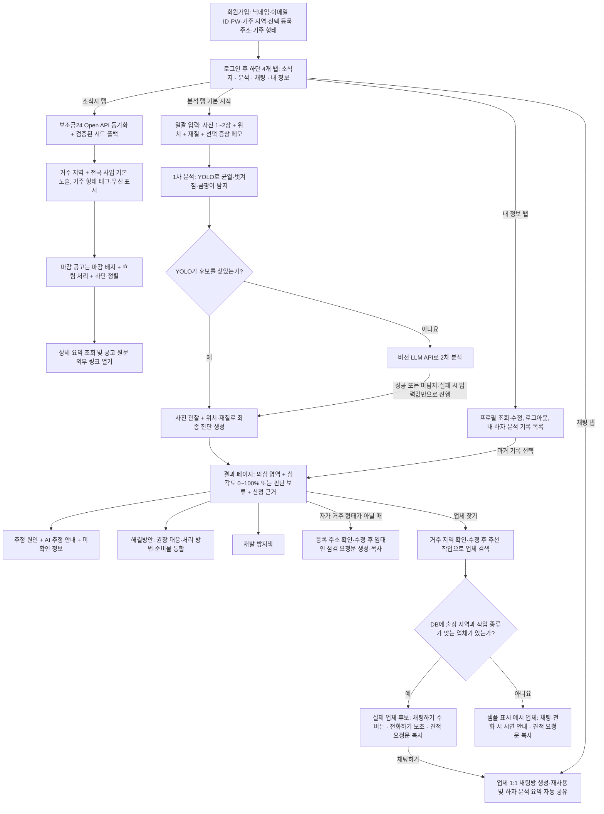

# 주거 하자 대응 에이전트

팀은 3명이며 11월 22일까지 완성하는 것을 목표로 한다. 공식 제출 마감은 11월 23일 17:00이다. [공식 해커톤 안내](https://korcham-careerfair.com/hackathon)

요청인(주로 청년 임차인)이 집에서 하자를 발견했을 때, 사진과 위치·재질을 입력받아 상태를 파악하고 심각도(%)·추정 원인·해결방안·재발 방지책을 안내하며, 직접 조치·임대인 점검 요청·업체 1:1 채팅 상담 및 주거 지원 사업 소식지 확인으로 이어가도록 돕는다. 지원 하자 유형은 **균열, 벗겨짐, 곰팡이**, 시연 지역은 **용인**으로 확정했다.

## 공식 제출 요건

- 필수 제출물은 지정 양식의 프로젝트 소개서, AI 활용내역, 실행 가능한 프로토타입이다. 소개서 별첨에 외부 자원의 출처·라이선스·이용 조건을 기록한다. 22일에는 팀 내부 개발 환경 밖에서도 제출본이 실행되는지 확인한다. [프로젝트 소개서 양식](https://drive.google.com/file/d/15gESCgdavnFcTF9xTV_3R2nZyhGbgC-P/view)
- 대표자가 신청 후 받은 링크에 업로드하고, 동일한 자료를 `korcham.careerfair@gmail.com`으로도 보낸다. 파일명은 `[팀명]_프로젝트명_AI 해커톤_제출일자`, 메일 제목은 같은 문자열 뒤에 ` / 과제제출`을 붙인다.
- 상세 목록에서 3분 이내 시연 영상과 개발 설명 자료는 선택 항목이다. 별도 공지의 요약에도 두 항목이 열거되어 있으므로 실제 제출 폼에서 필수 여부와 파일 형식을 확인한다.
- 예선 배점은 AI 활용 25점, 문제 정의 20점, 차별성 20점, 구현 20점, 활용·확장 15점이다. AI 오류·불확실성 대응은 AI 활용 25점 중 5점이다. 제출 마감 후 평가 대상 기능·알고리즘·프롬프트·데이터 변경은 금지된다. [공식 해커톤 안내](https://korcham-careerfair.com/hackathon)

### 첨부3 AI 활용 및 출처 표기 기준

- **AI 활용내역은 3,000자 이내**로 ① 서비스·개발에 사용한 모델과 도구 ② AI 작업과 팀 기여 ③ API·외부 데이터·오픈소스 ④ 검증 및 한계 대응 순으로 쓴다. 이 프로젝트의 AI 브레인스토밍·자료 조사·문서 초안도 실제 활용 범위에 포함한다. 코드 생성 비율 제한은 없으며 팀이 핵심 결정·검증을 주도하고 동작과 오류 대응을 설명할 수 있어야 한다.
- **외부 자원은 실제 사용분의 출처와 이용 조건을 확인한다.** YOLO·비전 LLM 등 채택한 모델·도구, 학습 및 검증 이미지와 데이터셋, 소식지 연동에 사용하는 공공데이터포털 `행정안전부_대한민국 공공서비스(혜택) 정보`(보조금24) Open API 및 공공누리(KOGL) 출처·이용 조건, 기타 오픈소스·미디어의 상세 출처를 소개서 별첨(및 앱·README)에 기록한다. AI 생성 이미지·영상에는 AI 생성 여부와 도구명을 표기한다. 사전 개발물을 사용했다면 제출 설문과 소개서 별첨에 종류·개발 시기·활용 범위를 동일하게 기록한다.
- **심사 기간 동안 실행을 유지한다.** 22일에는 팀 계정에서 로그아웃한 환경에서 심사위원의 접근·실행 경로를 확인한다. 예선 종료일인 11월 30일까지, 본선 진출 시 12월 7일까지 배포와 API 사용량·과금 설정을 유지한다. API 키·비밀번호·토큰은 코드·영상·발표자료에 노출하지 않는다. AI가 생성한 응답은 화면에 표시하는 것이 권장된다.
- 저장소 제출 시 제출 버전을 태그나 커밋으로 기록하는 것이 권장된다. 마감 후 허용되는 접속·인증정보·실행 환경 복구가 필요하면 운영사무국에 사유와 변경 내용을 알리고 이력을 남긴다. [AI 활용 및 출처 표기 기준 PDF](https://drive.google.com/file/d/1PPCIMds1RBXces430OeGF2D7mQWkrdyj/view)

## 팀 회의에서 나온 흐름

2026년 11월 20일 팀 회의 변경 사항을 반영한 전체 사용자 흐름이다. 일반 회원가입은 요청인 전용이며, 로그인 후 하단 4개 탭(`소식지`, `분석`, `채팅`, `내 정보`)으로 이동한다. 분석 페이지에서는 AI 채팅창을 제거하고 사진·위치·재질을 한 화면에서 일괄 입력받는다. (설문/객관식 추가 질문은 보류한다. 11월 21일 검토에서 업체 채팅은 WebSocket과 방별 미읽음 수 표시로 확정했으며 백엔드는 구현 완료, 모바일 화면은 후속 작업이다.)

## 11월 21일 프론트 시안 검토

시안의 표시 요소가 모두 구현 요구사항으로 확정된 것은 아니다. 아래에서 **확정**, **검토 중**, **회의 보류**, **후순위**를 구분한다. 확정된 항목도 구현 상태는 별도로 표시한다.

| 번호 | 항목 | 상태 | 결정 또는 다음에 정할 내용 |
| --- | --- | --- | --- |
| 1 | 카카오·Google 로그인 | 후순위 | 현재 MVP에서 제외한다. 시간이 남으면 재검토하며 도입을 약속하지 않는다. |
| 2 | 계정 인증 | 확정·백엔드 기반 완료 / 모바일 미구현 | Supabase Auth 이메일·비밀번호 방식을 사용한다. 일반 아이디 인증은 추가하지 않는다. FastAPI는 JWT 검증과 프로필 upsert(재시도 포함)를 제공하며, 회원가입 화면과 Supabase `signUp` 호출은 모바일 후속 구현이다. |
| 3 | 로그인 없이 둘러보기 | 검토 중 | 사용자 제안: 비회원에게 지역·거주 형태에 따른 개인화 없이 전체 소식·업체 목록을 보여준다. 도입 여부와 전체 목록의 범위·필터는 논의 후 결정한다. 도입 시에도 분석·기록·프로필·채팅은 인증을 유지한다. |
| 4 | 발생일과 기록 생성일 | 검토 중 | 날짜 의미를 실제 발생일 또는 최초 발견일 중 무엇으로 할지, 입력 자체가 필요한지, 필수/선택 여부를 정한다. 기록 생성일은 서버 등록 시각으로 유지한다. 추가 제안인 “분석을 해야 등록되는 흐름”과 날짜 입력 필요성을 함께 검토한다. |
| 5 | 과거 기록 사진 보관 | 검토 중 | 기기 내부 파일과 `record_id` 연결, 서버 스토리지, 원본 미보관 중 선택한다. 현재 서버는 원본을 보관하지 않는다. |
| 6 | 실제 진단·위험도·원인·대응 안내 | 구현 완료 | 사진 관찰 + 텍스트 LLM 2단계 진단, 심각도 구간 서버 정규화, 판단 보류 규칙을 구현했다. 남은 일은 실제 사진 세트 검증과 위험도 구간 튜닝이다. |
| 7 | 진단 신뢰도 필드 | 확정·미구현 / 세부 미정 | 필드를 추가한다. 무엇에 대한 신뢰도인지, 산정 근거·검증 방법·필드명·범위·산정 불가 시 표현은 미정이다. YOLO 개별 탐지 신뢰도와 구분하며 임의 수치를 넣지 않는다. |
| 8 | 진단 → 추천 작업 → 업체 검색 | 검토 중 | AI가 작업 종류를 제안하고 서버가 등록 작업으로 검증·매핑한 뒤 지역·작업 조건으로 DB 업체를 찾는 안을 검토한다. 책임 분담·매핑·추천 불가 시 처리는 아직 확정하지 않는다. |
| 9 | 가상 업체 문의·자동 응답 | 회의 보류 | 시연용 실제 계정 대화, 고정 자동 응답, AI 자동 응답 중 시연 방식을 정한다. 현재 샘플 후보는 채팅할 수 없으며 기존 시연 안내를 유지한다. |
| 10 | DM 실시간 통신·미읽음 수 | 확정·백엔드 구현 완료 / 모바일 미구현 | WebSocket `/chat/ws`와 방별 `unread_count`, `POST /chat/rooms/{room_id}/read`를 구현했다. 읽음 시점은 앱이 방에 들어가 이력을 받은 직후, 서버가 읽음 시각을 저장하고 다른 기기도 공유한다. 이벤트는 `ready`·`message`이며 재연결 후 REST 이력으로 맞춘다. 모바일 채팅 화면·푸시 알림은 후속이다. |
| 11 | 프로필 사진 | 제외 확정 | 프로필 사진 표시·변경·업로드는 구현 범위에서 제외한다. |

### 검토 근거와 선택지

- **비회원 열람 변경 범위**: 분석·개인 데이터 인증을 유지하면 전체 인증 구조를 바꿀 필요는 없다. 업체·지역·작업 종류 조회와 소식 상세는 공개 조회로 바꾸는 범위가 비교적 작다. 소식 목록은 현재 프로필의 지역·거주 형태를 읽으므로 비회원 조건을 처리하는 조회 분기가 필요하다. 앱의 로그인 진입 제한·열람 화면·보호 기능 진입 시 로그인 안내, 공개 API 응답 범위와 인증 회귀 검증도 필요하다. 추가 사용자 제안은 비회원에게 지역·거주 형태로 제한하지 않고 전체 소식·업체 목록을 보여주는 것이다. 이 안을 채택하면 비회원 기본 지역을 정할 필요는 줄지만 전체 조회 조건·정렬·페이지 처리는 검토해야 한다. “전체”는 공개 소식·업체 목록의 범위이며 개인 기록·프로필·채팅을 공개하는 의미가 아니다. 아직 확정하지 않았다. 비회원 열람을 위해 익명 계정이나 개인 기록을 만들 필요는 없다.
- **날짜 구분 이유**: 11월 10일 발견한 하자를 11월 21일 등록하면 발견일과 서버 생성일이 다르다. 경과 기간이나 임대인 요청문에 사용할 날짜를 등록 시각으로 대체하면 실제 관찰 이력과 달라질 수 있다. 발견일 입력을 채택하지 않으면 생성일을 등록일로만 표시하면 된다. 날짜 입력 추가를 확정한 것은 아니다.
- **분석 후 등록 제안(미확정)**: 사용자 제안인 “분석을 해야 등록되는 흐름”을 논의한다. 하자 기록 등록을 뜻하는지 등 등록 대상부터 확인하고, 기록 등록이라면 분석 요청 시 생성할지 성공 후 등록할지, 실패·취소 시 기록을 남길지, 날짜 입력을 생략하고 등록일을 사용할지 정한다. 현재의 기록 생성 후 분석 호출 방식은 변경하지 않는다.
- **로컬 사진 보관안**: 업로드용 임시 URI나 사진 보관함 링크만 기록하면 캐시 정리·권한 변경·원본 삭제로 사진이 사라질 수 있다. 로컬 방식을 택하면 앱 내부 영구 파일 영역에 복사하고 `(사용자 ID, record_id)`와 파일 경로를 연결하는 안이 가능하다. 계정별 접근·정리 정책을 정해야 하며 앱 삭제·기기 변경 시 복구나 다른 기기 열람은 보장하지 못한다. 서버 저장을 택하면 업로드·소유권 검증·조회 URL·보관/삭제 정책이 추가로 필요하다. 저장 위치는 아직 선택하지 않았다.
- **업체 추천 책임 분담 제안**: 진단 워크플로우는 필요한 작업을 제안하고, 백엔드는 허용된 작업인지 검증하고 DB에서 실제 업체를 검색하는 구성이 가능하다. 모델이 실제 업체 ID·연락처를 만들어 내도록 할 필요는 없다. 현재 검색 API는 있으나 샘플 진단의 `work_type_id`는 `null`이다. 업체 소개·전문 분야 태그의 데이터와 응답 확장 여부도 함께 논의한다.
- **시안/API 차이 추가 확인**: 시안에는 재질 입력이 없지만 현재 API는 필수다. 시안의 위험도 구간(60·80)과 현재 샘플 구간(40·70)이 다르다. 둘 다 이번 검토에서 변경하지 않고 입력 계약·진단 회의에서 정한다. 시안의 서울 선택과 실제 시드의 용인·경기도 범위도 연동 전에 확인한다.

## 합의한 범위

- **회원가입·계정·프로필**: 회원가입 시 `닉네임`, `ID(이메일)`, `PW`, `거주 지역`(필수), `등록 주소`(선택 입력 유지), `거주 형태`(`월세`, `전세`, `반전세`, `자가`, `기타`)를 입력받는다. 일반 가입은 `요청인` 전용이며, 시연용 `업체` 계정은 사전 등록한다. 인증은 이메일·비밀번호로 확정하며 카카오·Google 로그인은 시간 여유 시 재검토한다. 프로필 사진은 제외한다. 비밀번호 재설정은 후속 범위다.
- **거주 지역·등록 주소 보호**: 주소·지역이 필요한 단계마다 등록 주소와 거주 지역이 이번 하자 주택에 맞는지 확인하고 다르면 수정 후 사용한다. 기존 계정에 프로필이 없으면 먼저 등록한다. 업체 추천에는 확인한 거주 지역을, 임대인 점검 요청문에는 집 안의 하자 위치와 필요 시 앱에서 확인한 주소를 반영한다. 상세 주소는 외부 AI에 전달하지 않는다. *(상세 `등록 주소`를 계속 둘지 `거주 지역`만 수집할지는 팀 추가 논의 항목으로 둔다.)*
- **앱 하단 탭과 사용자 정보(`내 정보`)**: 요청인 로그인 후 하단 탭은 `소식지` · `분석` · `채팅` · `내 정보` 4개로 구성하고 기본 시작 탭은 `분석`이다. `내 정보` 페이지에서 프로필 조회·수정, 로그아웃, **내 하자 분석 기록 목록**을 제공하며 과거 기록을 선택하면 해당 **분석 결과 페이지**를 다시 열 수 있다.
- **소식지 페이지**: 주거 관련 정부·지자체 지원 사업을 모아 보여준다. 1차 데이터는 공공데이터포털 `행정안전부_대한민국 공공서비스(혜택) 정보`(보조금24) Open API(`gov24/v3/serviceList`, 개발계정 자동승인·무료·일 10,000회)를 백엔드에서 조회·필터링해 DB에 동기화·캐싱하고, API 지연·장애·지자체 누락에 대비해 검증된 실제 공고(전국·경기도·용인시 등)를 DB 시드로 함께 둔다. 사용자 `거주 지역 + 전국` 사업을 기본 노출(`전체 보기`/`진행중만 보기` 필터)하고 `거주 형태` 관련 사업은 태그·우선 표시한다. `신청기한` 원문(`deadline_text`)과 파싱·시드된 마감일(`deadline_date`)을 함께 저장해 마감일이 지난 공고만 `마감` 배지와 흐리게(dimmed) 표시 및 목록 하단 정렬을 적용한다(상시신청·날짜 미확정은 진행중 유지, 마감 공고도 클릭해 내용 열람 가능). 카드 클릭 시 앱 내 상세 요약과 `공고 원문/신청 페이지 열기` 외부 링크를 제공한다.
- **지원 하자 유형과 시연 지역**: 지원 하자 유형은 **`균열`, `벗겨짐`, `곰팡이`** 3종, 시연 지역은 **`용인`**으로 확정한다.
- **분석 페이지 일괄 입력 (채팅창 제거)**: 분석 페이지에서 AI 추가 질문 채팅창을 제거한다. 같은 하자의 전체 사진과 근접 사진을 최대 두 장(1장 필수, 2장째 선택) 받으며, 같은 화면에서 **위치**(대표 선택지 + 직접 입력), **재질**(대표 선택지 + 직접 입력), **증상 메모**(선택 입력)를 함께 입력받고 `분석하기`를 누르면 서버가 1차 사진 분석과 최종 진단을 연속 처리한다. 재촬영과 실제 면적 측정은 보류한다. 설문/객관식 형태의 추가 질문은 보류하며 추후 도입 여부를 논의한다. *(기존 코드에 구현된 AI 질문·메시지 API `questions`·`messages`·`next-question`은 당장 삭제하지 않고 `MVP 미사용(보류/레거시)`로 구분한다.)*
- **진단 신뢰도와 DM**: 진단 신뢰도 필드를 추가한다(정의·산정·필드 계약 미정). DM은 WebSocket과 채팅방별 읽지 않은 메시지 수 표시로 확정했고 백엔드를 구현했다. 읽음 시점은 방 이력 조회 직후로 정했으며, 모바일 화면과 푸시 알림은 후속이다.
- **분석 결과 페이지**: 탐지 성공 시 사진 위에 의심 영역을 표시하고, 진단 결과로 **`심각도`(0~100% 정수, 정보 부족 시 `판단 보류`, 산정 근거 포함)**, **`추정 원인`(가능한 원인 + AI 추정 안내 문구 + `미확인 정보`)**, **`해결방안`(권장 대응, 처리 방법과 준비물 통합)**, **`재발 방지책`**을 표시한다. 사진만으로 원인을 단정하지 않으며, AI 추정 안내는 "사진과 입력 정보를 바탕으로 한 AI 추정이며, 정확한 원인은 현장 점검이 필요합니다"를 고지해 불확실성 대응 기준을 지킨다.
- **결과 이후 다음 행동 (임대인 점검 요청 & 업체 추천·1:1 채팅)**:
  - `임대인 점검 요청문`은 유지하되, `거주 형태`가 **`자가`**인 요청인에게는 결과 화면에서 기본 숨긴다.
  - `업체 찾기`는 임대인에게 연락하기 전에도 이용할 수 있으며, 사진·위치·재질로 추천 작업을 미리 선택한다(판단이 어려우면 `원인 점검` 기본 선택 및 추천 이유 표시, 사용자 수정 가능).
  - 업체 검색은 DB에서 사용자가 확인한 거주 지역으로 출장 가능하고 해당 작업을 제공하는 실제 업체를 조회한다. 일치하는 업체가 없으면 `샘플` 표시가 붙은 예시 업체를 보여주고, 조회 오류는 별도로 표시한다.
  - 업체 후보 카드의 주 버튼은 **`채팅하기`**, 보조 버튼은 **`전화하기`**로 두고 기존 `SMS 메시지 보내기`는 앱 내 채팅으로 대체(제거)한다. `견적 요청문`은 채팅 첫 문의 초안·복사용으로 재활용한다.
  - 요청인이 분석 결과 → 업체 후보에서 `채팅하기`를 누르면 1:1 채팅방을 생성·재사용하고 해당 하자 분석 요약(하자 유형·위치·재질·심각도%·추정 원인)을 자동 공유한다. `샘플` 업체의 연락 버튼은 시연 안내를 띄우며 견적 요청문 복사는 가능하다.
  - 수리비 부담에 대해서는 계약 내용과 점검 결과 등 확인할 정보를 안내한다. [민법 제623조 및 제634조](https://www.law.go.kr/lsSc.do?eventGubun=060101&menuId=1&query=%EB%AF%BC%EB%B2%95&section=&subMenuId=15&tabMenuId=81)

## 기술 스택과 역할

| 담당 | 기술 | 작업 |
| --- | --- | --- |
| 앱 1명 | React Native · Expo | 4개 탭(`소식지`·`분석`·`채팅`·`내 정보`), 회원가입(닉네임·이메일·PW·거주 지역·등록 주소·거주 형태)·로그인, 소식지 목록(마감 흐림)·상세, 사진(1~2장)+위치+재질 일괄 분석 화면, 결과(심각도%·추정 원인·해결방안·재발 방지책·자가 예외 요청문 숨김), 업체 목록(`채팅하기`·`전화하기`·초안 복사), 1:1 채팅 화면, 내 정보·과거 기록 열람 |
| 백엔드 1명 | FastAPI · Supabase(DB) | 인증 확인·프로필(`GET/PUT /me/profile`)·사전 등록 업체 계정 연결, 소식지(보조금24 API 동기화+시드, 마감 판별, `GET /support-programs`), 일괄 분석·진단(`POST /records/{record_id}/analyze`), 기록 목록(`GET /records`), 요청문 생성, 업체 검색, 업체–요청인 채팅 API |
| 이미지 인식 1명 | 모델과 적용 범위는 담당자와 협의 | `균열·벗겨짐·곰팡이` 데이터 확인, YOLO·비전 LLM 비교 검증, 백엔드에 전달할 분석 결과 형식 협의 |

## 대표 사용자와 차별점

관리 전용 앱이 없는 거주자(특히 청년 임차인)가 사진과 위치·재질만으로 하자 상태를 파악하고, 심각도%와 원인·해결방안·재발 방지책을 확인한 뒤 상황에 맞게 직접 조치·임대인 점검 요청·업체 1:1 채팅 상담까지 끊김 없이 이어가며 관련 주거 지원 사업 소식지까지 한 앱에서 확인한다.

| 비교 서비스 | 공개된 기능 | 우리 데모에서 보여줄 부분 |
| --- | --- | --- |
| 숨고 | 시공·수리 업체 견적 매칭 | 업체에 바로 문의하기 전 사진·위치·재질로 심각도%와 원인을 추정하고, 자가/임차 거주 형태에 맞춰 임대인 점검 요청 또는 하자 요약을 포함한 업체 채팅으로 이어지는 단계 |
| AppFolio Realm-X | 사진 분석, 후속 질문, 작업 주문 생성 | 관리 플랫폼 연동 없이 거주자가 결과를 직접 검토해 임대인 연락·업체 1:1 채팅·주거 지원 사업 확인까지 한 번에 진행하는 흐름 |

[숨고 곰팡이 제거 견적 안내](https://frontend-next.soomgo.com/prices/%EA%B3%B0%ED%8C%A1%EC%9D%B4-%EC%A0%9C%EA%B1%B0) · [AppFolio Realm-X 기능 안내](https://www.appfolio.com/blog/small-medium-business)

시연에서는 용인 거주 임차인 계정으로 소식지의 진행중/마감(흐림) 주거 지원 사업을 확인한 뒤, 균열·벗겨짐·곰팡이 사례 사진과 위치·재질을 입력해 심각도%·추정 원인·해결방안·재발 방지책 결과를 확인하고, `내 정보`의 과거 기록 재열람과 업체 `채팅하기`(하자 요약 자동 공유) 흐름을 보여준다.

### 차별점 보완 후보

구현 난이도, 한계, 검증 방법과 추가 기능 후보를 [AI 아이디어 비교](../ideas/AI_IDEAS.md)에 정리했다.

1. **임대인 답장으로 후속 대응 초안 만들기.** 답장을 자동으로 가져올 수 있는 경로를 확보할 때 다시 검토한다. 기존 제안은 답장 붙여넣기였다. 기존 하자 기록 하나와 텍스트 입력으로 구현할 수 있지만, 팀은 수동 입력이 필요하면 활용 가치가 낮다고 봤다. 카카오톡 공개 메시지 API에서 개인 대화 수신 조회는 확인되지 않았다. 앱 공유를 통한 가져오기는 사용자 동작이 필요한 별도 후보다. [카카오톡 메시지 API](https://developers.kakao.com/docs/ko/kakaotalk-message/common) · [Expo Sharing](https://docs.expo.dev/versions/latest/sdk/sharing/)
2. **기록을 바탕으로 전달 전 누락과 단정 확인.** AI가 요청 초안에서 근거가 없는 원인 단정이나 누락된 위치 정보를 찾아 사용자에게 수정할 곳을 보여준다. 별도 화면을 추가할 여유가 없을 때, 기존 초안 검토 화면에서 구현할 수 있는 후보다.
3. **견적서의 작업 범위 비교.** 받은 견적에서 원인 점검, 제거, 마감 복구 항목을 뽑아 비교하고 명시되지 않은 항목에 대해 업체에 물을 질문을 만든다. 실제 견적 사례가 필요하고 이번 데모의 임대인·업체 상담 진입 단계보다 뒤 단계라 후속 후보로 둔다.

AppFolio도 사진 분석, 후속 질문과 작업 주문 생성을 제공한다. 위 후보는 거주자가 평소 쓰는 연락 채널이나 업체 채팅에서 받은 답장을 기존 하자 기록에 이어 쓰는 경험을 검증하기 위한 것이다. 경쟁 서비스 전체에서의 기능 유일성은 확인 전이다. [AppFolio Realm-X 기능 안내](https://www.appfolio.com/blog/small-medium-business)

### 후속 후보: RAG·MCP

민법 조문 조회 MCP와 RAG는 후속 후보로 둔다. 이번 시연은 사진+위치·재질 일괄 분석과 결과 안내, 임대인 점검 요청, 업체 추천·1:1 채팅, 주거 지원 사업 소식지 흐름에 집중한다.

**후속 탐색 후보는 민법 조문 조회 MCP다.** 결과 화면의 `왜 임대인에게 먼저 알리나요?`에서 읽기 전용 도구가 관련 조문을 가져온다. 응답에는 조문 번호, 원문, 시행일, 출처 링크를 포함한다. 앱은 확인된 사례 사실, 조문이 설명하는 일반 원칙, 원인·계약 특약처럼 추가로 확인할 정보를 보여준다. 조문 조회에는 사용자의 사진, 주소, 대화 원문을 전달하지 않는다. 조회 실패 시 근거를 가져오지 못했음을 표시하고 기존 점검 요청문 흐름은 이어간다. 법제처 API 접근과 기존 커뮤니티 MCP의 동작을 먼저 확인한다. [법제처 API 안내](https://open.law.go.kr/LSO/openApi/guideList.do)

| 후보 | 사용자에게 보여줄 결과 | 검증할 점 |
| --- | --- | --- |
| RAG로 임대인 답장에 대응 | 기존 하자 기록과 답장을 바탕으로 검토한 공식 자료에서 관련 항목을 찾아, 확인할 사실과 보낼 답장 초안을 원문 링크와 함께 제시한다. | 검색 결과가 질문과 실제로 관련 있는지, 인용이 안내를 뒷받침하는지, 근거가 부족할 때 비용 부담 판단을 보류하는지 확인한다. |
| MCP로 공식 경로 조회 | 임대인 연락 이후에도 해결되지 않을 때 AI가 읽기 전용 도구로 상담·조정 기관이나 준비 서류를 조회해 공식 링크를 제시한다. | 조회 도구와 데이터 접근이 가능한지, 결과가 비거나 호출이 실패할 때 어떻게 안내할지 확인한다. 검색에는 개인 사진이나 대화 원문을 전달하지 않는다. |
| MCP로 하자 기록 재사용 | 사용자가 선택한 하자 기록에서 확인된 사실을 조회해 점검·답장·견적 초안에 재사용한다. | FastAPI 내부에서 같은 기록을 읽는 방식으로도 현재 앱의 요구를 충족한다. 여러 AI 앱에서 같은 도구를 재사용할 필요가 생기면 MCP 도입 근거가 된다. |

[국가법령정보 공동활용](https://open.law.go.kr/LSO/information/service.do) · [MCP 공식 명세 안내](https://blog.modelcontextprotocol.io/posts/2026-07-28/)

## 분석 결과와 초안 생성

- 분석 화면에서 AI 추가 질문 채팅창을 제거했으므로, 한 번에 받은 **사진(1~2장) · 위치 · 재질 · 선택 증상 메모**만으로 진단 결과를 생성한다. 사진 관찰(YOLO·SAM·비전 LLM 보조)과 텍스트 구조화 진단을 2단계로 분리해 구현했다([ADR 0001](../adr/0001-two-stage-vision-and-text-diagnosis.md)).
- 심각도를 판단할 정보가 부족하면 `판단 보류`로 표시하고, 확인하지 못한 조건(예: 누수 여부, 재발 기간, 배관 위치)은 `미확인 정보`로 명시한다.
- 사진에서 관찰한 흔적과 사용자가 입력한 위치·재질·메모를 구분하며, 원인 섹션에는 **AI 추정 안내 문구**를 함께 띄워 단정을 피한다.
- 기존 코드에 구현된 AI 질문·메시지 API(`questions`·`messages`·`next-question`)는 MVP에서 호출하지 않으며, 설문/객관식 추가 질문은 추후 확장 여부로 보류한다.

### 일괄 분석·초안 생성이 실패했을 때

| 실패 지점 | 화면에서 이어갈 수 있는 행동 |
| --- | --- |
| 사진 분석만 실패 또는 미탐지 | 이미 입력한 위치·재질·증상만으로 진단을 이어가고 결과에 사진 분석 미반영(필요 시 `판단 보류`)을 표시한다. |
| 전체 일괄 분석·진단 생성 실패 | 입력한 사진·위치·재질을 유지하고 `다시 시도`를 제공한다. 기존 진단이 있었다면 실패 응답으로 덮어쓰지 않는다. |
| 점검 요청문 또는 견적 초안 생성 실패 | `다시 시도`와 `기본 양식 보기`를 제공한다. 기본 양식은 LLM 호출 없이 현재 하자 기록의 위치·재질·확인된 증상·심각도만 채운다. 사용자는 양식을 수정하고 복사할 수 있다. |

## 통합 계획

Expo에서 사진(1~2장)과 위치·재질·선택 증상 메모를 `POST /records/{record_id}/analyze`로 보내면, FastAPI가 사진 관찰(YOLO·SAM → 필요 시 비전 LLM)과 텍스트 진단(`심각도%`·`추정 원인`·`해결방안`·`재발 방지책`)을 순서대로 처리해 반환한다. 진단만 다시 만들 때는 `POST /records/{record_id}/diagnosis`를 쓴다. FastAPI는 사용자별 프로필, 하자 기록, 소식지 지원 사업, 업체·채팅 데이터를 Supabase DB에 저장한다.

11월 20일 통합에서는 앱과 백엔드를 샘플 분석 결과로 먼저 연결했고, 이후 사진 관찰·텍스트 진단 경로를 구현했다. 두 모델 경로가 모두 미설정이면 샘플 모드로 동작하며, 시연에서 샘플 결과를 사용하면 화면이나 발표에서 샘플임을 밝힌다.

## 사진 분석의 불확실성 대응

학습에 쓰지 않은 동일 사진으로 YOLO와 비전 LLM을 먼저 비교한다. 확정된 하자 유형(`균열`, `벗겨짐`, `곰팡이`)의 검증 결과를 바탕으로 비전 LLM 모델과 YOLO의 구체적인 신뢰도 기준을 이미지 인식 담당자와 협의한다.

- YOLO가 하자 후보를 찾지 못했거나 결과가 불명확하면, 비전 LLM에 YOLO의 결론을 주지 않고 사진에서 보이는 흔적, 대략적 위치, 판독이 어려운 이유를 묻는다.
- 비전 LLM을 호출하지 않은 경우, YOLO가 찾은 영역을 사진 위에 `의심 흔적`으로 표시한다. 두 분석에서 모두 의심 영역을 찾지 못하면 `사진에서 의심 영역을 찾지 못했어요`를 표시하되, 사용자가 함께 입력한 **위치·재질·증상만으로** 결과를 생성해 흐름을 이어간다.
- 두 분석이 일치하면 화면에 `의심 흔적`으로 표시하고, 비전 LLM만 관찰을 반환하거나 두 결과가 다르면 후보로 함께 안내한다. 사진 자체가 흐리거나 어두워 판독이 어려워도 입력한 위치·재질로 결과를 생성한다. 재촬영은 보류한다.
- 두 모델이 일치해도 원인을 확정하지 않는다. 결과 화면의 `추정 원인`에는 AI 추정 안내와 미확인 정보를 함께 표시하고, 요청문에는 사진 관찰 현상, 사용자가 입력한 위치·재질, 추가 점검 필요 내용을 구분한다.

### 주거 사진 처리 기준

- **현재 구현과 기존 보관 기준**: 원본 사진은 앱의 현재 분석·결과 화면과 FastAPI의 분석 요청 처리에만 사용한다. 과거 기록에서 사진을 다시 보여주기 위한 기기 보관·서버 저장 여부는 11월 21일 검토에서 재논의 항목으로 분리했으며 아직 변경하지 않는다. Supabase, 서버 로그, 백업에 사진을 남기지 않는다. 서버 임시 파일을 사용하면 처리 성공·실패 모두에서 삭제한다. 사용자 기기의 사진 보관함에 있는 원본은 사용자가 관리한다.
- Supabase에는 사용자별 하자 기록에 필요한 위치·재질·증상 메모·관찰 요약·진단·초안을 저장한다. 현재 서버는 원본 사진을 보관하지 않지만 YOLO 탐지 좌표·신뢰도·SAM 마스크·화면 점유 비율은 관찰 결과로 저장한다. 원본 사진은 [ADR 0002](../adr/0002-private-storage-for-defect-photos.md)에 따라 비공개 Storage와 단기 Signed URL로 보관할 예정이며, 보유기간·삭제 정책은 개인정보 검토와 함께 확정한다.
- 대회에서는 동의 여부와 관계없이 실제 개인정보·민감정보를 외부 AI 서비스에 보내지 않는다. 외부 비전 모델에는 팀이 확인한 가상·샘플·비식별 사진만 보낸다. 호출 전에 사진과 제공사, 목적을 안내하고 동의를 받는다. 비식별 여부나 제공사의 보관 정책이 미확인이거나 동의를 거절하면 사진 외부 분석을 건너뛰고 입력한 위치·재질로 결과를 생성한다. [공식 해커톤 안내](https://korcham-careerfair.com/hackathon)
- 이 전송 기준은 텍스트 LLM에도 적용한다. 시연에는 가상 답변을 쓰고, 외부 모델에 전달할 메모에 실제 개인정보가 들어 있으면 제거하거나 해당 호출을 건너뛴다. [첨부3 제7조](https://drive.google.com/file/d/1PPCIMds1RBXces430OeGF2D7mQWkrdyj/view)

### 데모 검증안

**SAM 채택 기준.** 이미지 인식 담당자가 같은 검증 사진에서 SAM을 비교한 뒤 앱 통합 여부를 결정한다. SAM 3에 사용자가 찍은 점이나 지정한 영역을 입력해 YOLO 마스크보다 보이는 흔적의 위치와 경계를 설명하기 쉬운지 확인한다. 이 실험은 자동 탐지와 구분해 기록한다. 기준 마스크가 있으면 경계 품질을 비교하고, 처리 시간과 사용자가 영역을 수정해야 한 횟수도 확인한다. [Meta SAM 3](https://ai.meta.com/research/sam3)

학습에 사용하지 않은 같은 사진 세트로 YOLO 단독, 비전 LLM 단독, 보조 판독을 포함한 앱 흐름을 비교한다. 명확한 흔적, 비슷해 보이는 일반 얼룩, 흐리거나 어두운 사진을 포함한다. 팀이 각 사진의 관찰 가능 범위와 기대 동작을 먼저 기록하고 의심 유형, 위치, 오탐·미탐, 판단 보류, 결과·요청문에 들어간 확인되지 않은 단정을 비교한다. 영역 마스크 품질은 기준 마스크가 있는 사진에서 평가한다. 소규모 데모 결과는 확인한 사례와 실패 대응을 설명하는 근거로 사용한다.

발표에서는 애매한 사진 한 장을 넣어 모델 결과가 어떻게 표시되고, 사진 미탐지·분석 실패 시에도 위치·재질 기반 결과와 `판단 보류`·`미확인 정보`가 어떻게 표시되는지 보여준다. 이는 팀이 공유한 평가 항목인 AI 결과의 오류와 불확실성에 대한 대응을 시연하기 위한 것이다.

| 목표일 | 확인할 결과 |
| --- | --- |
| 11월 19일 | 앱과 백엔드가 분석 결과 예시, 기록 저장 형식, 초안 생성 요청 형식을 맞춘다. 이미지 담당자와 실제 분석 통합 시점을 협의한다. |
| 11월 20일 | 팀 회의 변경 사항(가입 항목, 소식지, 채팅 없는 일괄 분석, 결과 3대 섹션, 업체 1:1 채팅, 내 정보)을 설계에 반영하고 앱·백엔드 통합을 시작한다. |
| 11월 21일 | 아래 MVP 검증표를 실행하고, 팀 휴대폰에서 대표 사례로 발표를 리허설한다. |
| 11월 22일 | 21일에 선택한 시연 경로를 휴대폰에서 다시 실행하고 제출물을 마무리한다. |

### 실제 모델 시연 결정

- 11월 21일 리허설 전에 휴대폰에서 실제 사진+위치·재질 업로드, 모델의 의심 영역 표시, 사진 분석 실패 시 입력값 기반 결과 전환을 확인한다. 이 흐름을 통과하면 실제 모델을 발표에 포함한다.
- 실제 모델을 연결하지 못했거나 위 검증을 통과하지 못하면, `위치·재질 입력(또는 샘플 사진 분석) → 결과(심각도%·추정 원인·해결방안·재발 방지책) → 점검 요청문·업체 채팅`을 실제 앱으로 시연한다. 이미지 분석을 별도로 설명할 때 샘플 결과를 사용하면 화면이나 발표에서 샘플임을 표시한다.
- 11월 22일 팀 내부 완료 기준은 선택한 경로의 재검증과 공식 제출물 준비다.

### 11월 21일 MVP 검증표

앱·백엔드 담당자가 시연 기기와 연결된 서버에서 아래 항목을 실행하고 결과를 `통과`, `실패`, `미검증`으로 기록한다. 모델 분기는 샘플 응답으로 앱 동작을 확인할 수 있다. 실제 모델 성능과 연동 결과는 이미지 인식 담당자가 별도로 기록한다.

| 검증 항목 | 통과 기준 |
| --- | --- |
| 회원가입과 프로필 재사용 | 가입 시 닉네임, 이메일 ID, PW, 거주 지역(필수), 등록 주소(선택), 거주 형태(`월세·전세·반전세·자가·기타`)를 저장한다. 필요한 단계에서 등록 주소·거주 지역을 확인·수정할 수 있고, 프로필 저장 실패 시 재시도 및 다른 사용자 프로필 접근 거부를 확인한다. |
| 로그인과 기록 접근 권한 | 준비한 요청인 계정 두 개로 로그인한다. 두 번째 계정이 첫 번째 계정의 기록 ID를 요청해도 조회 또는 초안 생성이 거부된다. |
| 내 정보와 과거 기록 열람 | `내 정보` 페이지에서 프로필 조회·수정, 로그아웃이 동작하고 `내 하자 분석 기록 목록`에서 과거 기록을 눌러 결과 페이지를 다시 열 수 있다. |
| 소식지 노출과 마감 표시 | 거주 지역(용인) + 전국 주거 지원 사업이 기본 노출되고 거주 형태 태그가 표시된다. `마감` 공고는 흐리게 표시되고 하단으로 정렬되며 클릭해 상세 요약과 외부 원문 링크를 열 수 있다. API 장애·미연동 시 시드 폴백이 동작한다. |
| 일괄 분석과 기록 분리 | 분석 페이지에 채팅창 없이 사진(1~2장), 위치, 재질(선택지+직접 입력), 선택 증상을 한 번에 제출해 결과를 받는다. 같은 사진으로 새 기록을 시작해도 이전 값·결과가 섞이지 않으며, 위치·재질을 바꾸면 새 결과에 반영된다. |
| 사진 일부·전체 실패 폴백 | 두 장 중 한 장만 분석에 성공하면 성공 결과를 반영하고 실패 사진을 표시한다. 모든 사진 분석이 실패하거나 외부 분석에 동의하지 않아도 함께 입력한 위치·재질만으로 결과를 생성한다. |
| YOLO 단독 및 2차 분석 | YOLO 탐지 시 `의심 흔적`이 표시되고, 미탐지·불명확 시 비전 LLM 2차 분석을 호출한다. 두 분석 모두 결과가 없으면 안내를 표시하고 위치·재질 기반 결과로 이어간다. |
| 주거 사진 보관과 외부 전달 | 분석 성공·실패 후 DB와 로그에 원본이 남지 않고 임시 파일이 삭제된다. 동의 전·거절 후·비식별 미확인 시 외부 비전 모델 호출 없이 입력값만으로 결과를 생성한다. |
| 결과 페이지 3대 섹션과 심각도% | 심각도 `0~100%`(정보 부족 시 `판단 보류`)와 산정 근거가 표시된다. `추정 원인`(AI 추정 안내 + 미확인 정보), `해결방안`(처리 방법·준비물 통합), `재발 방지책`이 함께 표시된다. |
| 거주 형태별 점검 요청문 | 임차 거주 형태(`월세·전세·반전세·기타`)에서는 `임대인 점검 요청문`과 `업체 찾기`가 보이고, `자가` 거주자 결과 화면에서는 `임대인 점검 요청문`이 숨겨진다. |
| 점검·견적 요청문 생성 실패 | 실패 시 기존 초안이 유지되고 `다시 시도`와 LLM 호출 없는 `기본 양식` 수정·복사가 각각 동작한다. |
| 검색 작업 제안과 업체 검색 | 사진·위치·재질로 작업 종류가 미리 선택되고(불명확 시 `원인 점검` + 추천 이유) 수정 검색이 가능하다. 용인 출장 가능·작업 일치 DB 업체가 있으면 실제 후보를, 없으면 `샘플` 후보를 반환하며 DB 오류를 빈 결과와 구분한다. |
| 업체 채팅과 연락 버튼 | 실제 업체 카드의 주 버튼 `채팅하기`를 누르면 요청인–업체 1:1 채팅방으로 진입해 하자 분석 요약이 자동 공유되고, 사전 등록된 업체 계정과 메시지를 주고받을 수 있다. 보조 버튼 `전화하기`는 전화 화면을 열고, 견적 요청문은 채팅 초안·복사로 사용할 수 있다. `샘플` 업체는 시연 안내를 띄운다. |

발표 리허설에서는 용인의 `균열·벗겨짐·곰팡이` 사례로 위 기준에 따라 선택한 경로를 시연한다. 업체 연결은 실제 업체와 1:1 채팅방에서 하자 요약 공유 및 대화를 시연하고, `전화하기`는 전화 화면을 여는 단계까지 확인한다.

## 2~4단계 확정 설계 (구현 예정)

2단계로 분석 전 지역 확인(`records.region_id` 스냅샷, `012`)과 소식지 목록 페이지네이션(`limit`/`offset`, `total`/`has_more`)을 구현했다. 사진 비공개 Storage·단기 Signed URL, 소식지 주기 동기화, 업체 평점·상세, 견적 요청서·제안서·수락 매칭은 확정 설계로 둔다. 매칭은 지역·특화 분야가 맞는 업체에 1:N으로 공개하고 제안서 중 1건만 수락한다. 근거는 [ADR 0002](../adr/0002-private-storage-for-defect-photos.md), [ADR 0003](../adr/0003-open-quote-request-and-proposal-matching.md)를 따른다.

## 다음에 결정할 사항

- **등록 주소 수집 범위**: 회원가입 시 상세 `등록 주소` 입력(선택)을 계속 둘지, `거주 지역`만 수집할지 최종 결정한다.
- **설문/객관식 추가 질문 보류 범위**: 분석 페이지에서 채팅창을 제거한 뒤, 설문/객관식 형태의 추가 질문을 후속 기능으로 추가할지 여부와 시점을 결정한다.
- **요청문 생성의 증상 메모 외부 전송**: 증상 메모 원문을 외부 LLM 입력으로 사용할지, 사용 시 동의·고지(수신자·목적·항목·보유기간·국외 이전·거부권)와 동의값 저장·미동의 시 동작(제외 후 생성 vs 생성 거부)을 팀 회의에서 정한다. 결정 전에는 현재 구현을 유지하되, 실제 사용자 데이터 대신 가상 데이터 또는 자체 모델로 시연한다.
- **시안 검토 미정 사항**: 비회원 열람·기본 지역, 발생/발견일 입력, 사진 보관, 신뢰도 정의·산정·필드 계약, 추천 작업 연결, 가상 업체 시연 방식은 위 시안 검토 표에 따라 결정한다.
- **업체–요청인 채팅 세부 구성**: WebSocket과 방별 미읽음 수 표시는 백엔드에 구현했다. 읽음 시점은 방 이력 조회 직후, 읽음 상태는 서버 저장으로 기기 간 공유, 재연결은 REST 이력 동기화로 정했다. 모바일 채팅 화면·시연용 업체 계정 화면 구성과 푸시 알림 도입 여부는 남아 있다.
- **모델 기준 확정**: 이미지 인식 담당자와 `균열·벗겨짐·곰팡이`별 심각도 `%` 산정 기준과 YOLO → 비전 LLM 2차 분석 호출 기준을 확정한다.
- **시연 데이터 및 계정 준비**: 용인시 시연에 맞는 실제 업체 몇 곳의 업체명·연락처·출장 지역·작업을 확인해 DB에 등록하고, 시연용 사전 등록 `업체` 계정과 실제 후보/샘플 후보 검색 시나리오를 준비한다.
- **규정·제출 확인**: 개인정보 수집 범위·보유기간과 외부 DB 보관에 대한 대회 규정 확인, 대표자가 받은 제출 폼의 허용 확장자·용량 제한·선택 항목 표시를 확인한다.

## 결정과 제안 이력

이후 팀이 기존 제안과 다른 안을 선택하면 최종 결정과 이유, 기존 제안과 근거를 함께 기록한다.

| 항목 | 결정 또는 상태 | 기존 제안과 근거 |
| --- | --- | --- |
| 앱과 역할 | Expo 앱, FastAPI·Supabase 백엔드, 이미지 인식을 각 한 명이 맡는다. | 모바일 웹은 설치와 기기 설정 부담을 줄여 데모 통합을 앞당기기 위해 제안했다. |
| 회원가입 항목과 이메일 ID | 가입 시 `닉네임`, `ID(이메일)`, `PW`, `거주 지역`(필수), `등록 주소`(선택), `거주 형태`(`월세·전세·반전세·자가·기타`)를 입력받는다. 일반 가입은 `요청인` 전용이고 시연용 `업체` 계정은 사전 등록한다. | 기존에는 거주 지역·상세 주소만 받았고 일반 아이디(username) 방식도 검토했으나, 기존 Supabase Auth·이메일 로그인 구현과 가장 잘 맞고 소식지·업체 채팅 역할 구분이 명확해 이메일 ID와 거주 형태·닉네임을 확정했다. (`등록 주소` 유지 여부는 추가 논의 예정) |
| 소식지 페이지 | `소식지` 탭에서 주거 관련 지자체·정부 지원 사업을 제공한다. `공공데이터포털 보조금24 Open API` 동기화·캐싱을 1차 소스로 쓰고, 검증된 실제 공고 시드를 폴백으로 둔다. 마감 공고는 `마감` 배지와 흐림 처리, 하단 정렬한다. | 초기 MVP 계획에는 없었으나 팀 회의에서 거주자 맞춤형 지원 사업 안내 필요성이 확인되어 추가했다. |
| 분석 페이지 채팅창 제거 및 일괄 입력 | 분석 페이지 AI 추가 질문 채팅창을 제거한다. 한 화면에서 사진(1~2장)·위치·재질(+선택 증상 메모)을 함께 입력하면 서버가 사진 분석과 진단을 연속 처리한다. 설문/객관식 추가 질문은 보류(논의 항목)하며, 기존 구현된 `questions`·`messages`·`next-question` 코드·테이블은 레거시/보류로 둔다. | 기존에는 1차 사진 분석 뒤 `next-question` 채팅으로 최대 2~3문항 또는 끝까지 추가 질문을 주고받았다. 입력 피로도를 낮추고 핵심 화면을 단순화하기 위해 일괄 입력으로 전환했다. |
| 지원할 하자 유형과 시연 지역 | 지원 하자 유형은 **`균열`, `벗겨짐`, `곰팡이`**, 시연 지역은 **`용인`**으로 확정했다. | 기존에는 지원 하자 유형과 시연 동네가 미정 상태였으며 창가 곰팡이 사례만 시연 후보로 두었다. |
| 심각도%와 분석 결과 3대 섹션 | 심각도는 **`0~100%`**(정보 부족 시 `판단 보류`)와 산정 근거로 표시하고, 결과 본문을 **`추정 원인`(AI 추정 안내 + 미확인 정보) · `해결방안`(처리 방법·준비물 통합) · `재발 방지책`** 3개 섹션으로 표시한다. | 기존에는 심각도를 `낮음·중간·높음` 3단계 텍스트로만 두고 처리 방법과 재발 방지 안내가 분리되어 있지 않았다. |
| 거주 형태별 임대인 요청문 | `임대인 점검 요청문`은 유지하되 `자가` 거주 형태 요청인에게는 기본 숨긴다. | 기존에는 모든 사용자를 임차인으로 전제하고 점검 요청문을 항상 노출했다. |
| 내 정보 페이지와 과거 기록 열람 | 하단 4개 탭(`소식지`·`분석`·`채팅`·`내 정보`, 기본 `분석`)을 두고, `내 정보`에서 프로필 조회·수정, 로그아웃, `내 하자 분석 기록 목록`(클릭 시 결과 재열람)을 제공한다. | 기존에는 별도 마이페이지가 없고 최근 기록 목록을 보류했다. |
| 업체 추천과 1:1 채팅 | 업체 카드의 주 버튼을 `채팅하기`로, 보조 버튼을 `전화하기`로 두고 `SMS 메시지 보내기`는 제거한다. 분석 결과에서 진입 시 하자 분석 요약을 자동 공유하며, 견적 요청문은 채팅 초안·복사로 재활용한다. 11월 21일 검토에서 실시간 통신은 WebSocket, 목록은 방별 미읽음 수 표시로 확정했고 백엔드를 구현했다. 모바일 채팅 화면과 업체 화면 세부는 후속이다. | 기존에는 업체 후보마다 `전화하기`와 `메시지 보내기`(외부 SMS 앱)만 연결했고 앱 내 채팅 페이지는 없었다. |
| 업체 후보 데이터 | 팀이 시연 지역(용인)과 작업에 맞는 업체 몇 곳의 업체명, 연락처, 출장 가능 지역, 작업 종류를 확인해 DB에 직접 등록한다. 검색 시 출장 가능 지역과 작업 종류가 모두 맞는 DB 업체가 있으면 실제 정보를, 없으면 `샘플` 표시가 붙은 예시 업체를 보여준다. | 데모에서 샘플 후보만 제공하는 안을 검토했다. |
| 프로젝트 목표 | 사진과 위치·재질로 하자 상태를 파악하고 심각도%·원인·해결방안·재발 방지책 안내, 임대인 점검 요청, 업체 1:1 채팅 상담, 주거 지원 사업 소식지 확인으로 이어가도록 돕는다. | 기존 계획은 임대인 점검 요청과 추가 질문 채팅을 중심으로 삼았다. |
| 업체 전화 시연 | 실제 업체의 `전화하기` 버튼은 전화 화면을 여는 단계까지 시연한다. | 시연은 전화 발신 직전까지 진행한다. |
| RAG와 MCP | 민법 조문 조회 MCP와 RAG는 후속 후보로 둔다. | 이번 시연에서는 일괄 분석, 결과 안내, 업체 채팅, 소식지 흐름 검증에 집중한다. |
| 직접 조치 준비물 | MVP에서는 `해결방안` 안에 처리 방법과 준비물을 함께 보여준다. 보유 도구를 묻고 답변에 따라 다른 방법을 제안하는 기능은 후속 범위다. | 보유 도구에 맞춰 처리 방법을 제안하는 안을 검토했다. |
| 사진 분석이 불명확할 때 | YOLO가 후보를 찾지 못하면 비전 LLM을 호출한다. 두 분석 모두 결과가 없거나 실패해도 함께 입력한 위치·재질만으로 결과를 생성한다. | 기존에는 분석 실패 시 별도 직접 입력 화면으로 전환한 뒤 추가 질문을 이어갔다. |
